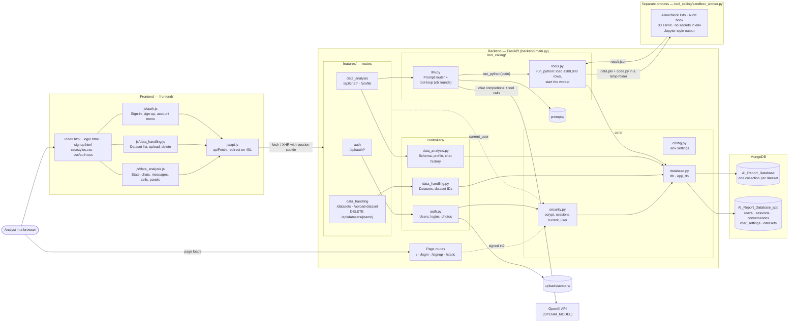
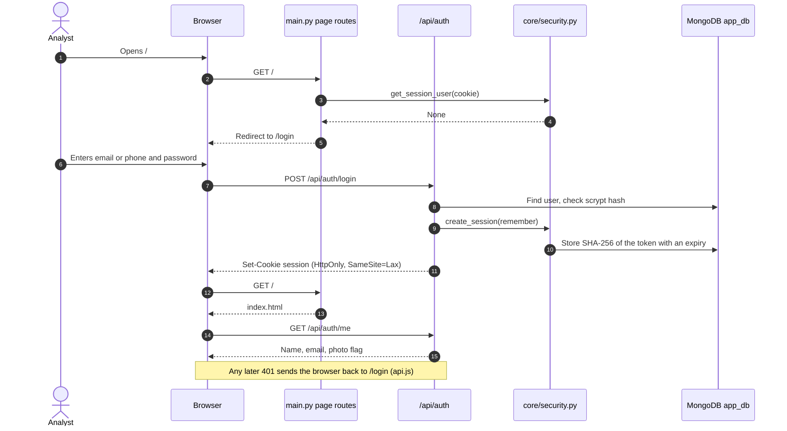
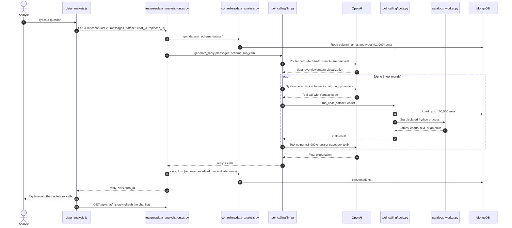

# Architecture

AI Report Analyst is one FastAPI process. It serves the browser app, signs users in, stores datasets and chat history in MongoDB, asks OpenAI to write Pandas code, and runs that code in a separate sandboxed Python process.

For details, see the [backend README](../backend/README.md) and the [frontend README](../frontend/README.md). The diagrams use Mermaid, which GitHub, GitLab and VS Code (with a Mermaid extension) render.

## Components

Each feature keeps HTTP handling in `features/<name>/routes.py` and the work in `controllers/<name>.py`. Everything shares one MongoDB client and one set of settings from `core/`.

## Pages and sign-in

## How a chat question is answered

## Dataset lifecycle

```mermaid
flowchart LR
    file["CSV / XLSX / XLS file"] -- "POST /upload-dataset<br/>(data_handling.js, XHR with progress)" --> check["Name and extension checked<br/>Duplicate names refused"]
    check --> parse["Pandas reads the file<br/>NaN → null"]
    parse --> insert["insert_many into<br/>a new collection"]
    insert --> id["get_dataset_id assigns<br/>a 10-digit ID from the rows"]
    id --> select["Selected in the Datasets panel<br/>Saved in chat_settings"]
    select --> analyse["Used by chat and profiling"]
    analyse -- "DELETE /api/datasets/{name}" --> drop["Collection dropped<br/>Name unlinked from its ID<br/>Unselected if selected<br/>Saved chats kept"]
```

## Data stores

| Store | Collection or folder | Contents |
| --- | --- | --- |
| `AI_Report_Database` (`MONGO_DB_NAME`) | one per dataset | Uploaded or existing rows. Every collection here is listed as a dataset. |
| `AI_Report_Database_app` | `users` | Accounts and their password hashes. Email and phone are unique. |
| | `sessions` | SHA-256 hashes of session tokens. A TTL index removes expired ones. |
| | `conversations` | `turn` and `note` documents, grouped into chats by `chat_id`. |
| | `chat_settings` | The selected dataset. |
| | `datasets` | Dataset IDs, content fingerprints, row counts and names. |
| Disk | `uploads/avatars/` | Profile photos, named by user ID. |

Chat history, datasets and the selected dataset are shared by every signed-in user. Users and sessions are the only per-user data.

## Deployment

One container (`Dockerfile`, `docker-compose.yml`) runs `uvicorn backend.main:app` on port 8000, with `./uploads` and `./frontend` mounted. MongoDB and OpenAI are external services. The profile route `POST /api/datasets/{name}/profile` exists, but the frontend does not call it.
