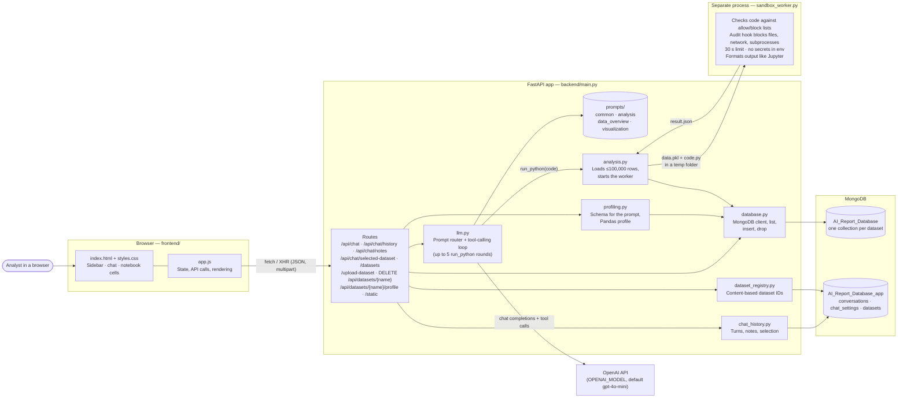
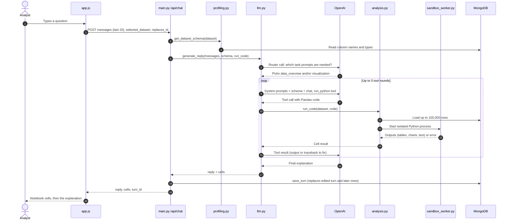

# Architecture

AI Report Analyst is one FastAPI process. It serves the browser app, stores datasets and chat history in MongoDB, asks OpenAI to write Pandas code, and runs that code in a separate sandboxed Python process.

The diagrams use Mermaid, which GitHub, GitLab, and VS Code (with a Mermaid extension) render.

## Components

## How a chat question is answered

## Dataset lifecycle

```mermaid
flowchart LR
    file["CSV / XLSX / XLS file"] -- "POST /upload-dataset" --> parse["Pandas reads the file<br/>NaN → null"]
    parse --> insert["insert_many into<br/>a new collection"]
    insert --> id["dataset_registry assigns<br/>a 10-digit ID from the rows"]
    id --> select["Selected in the app<br/>and saved in chat_settings"]
    select --> analyse["Used by chat and profiling"]
    analyse -- "DELETE /api/datasets/{name}" --> drop["Collection dropped<br/>Name unlinked from its ID<br/>Unselected if selected"]
```

## Data stores

| Database | Collection | Contents |
| --- | --- | --- |
| `AI_Report_Database` (`MONGO_DB_NAME`) | one per dataset | Uploaded or existing rows. Every collection here is listed as a dataset. |
| `AI_Report_Database_app` | `conversations` | `turn` documents (question, answer, cells, dataset, dataset ID) and `note` documents. |
| | `chat_settings` | The selected dataset. |
| | `datasets` | Registry of content fingerprints, row counts, and the names each ID has had. |

## Not in the main path

- `app/config/settings.py` and `app/database/mongodb.py` define another settings and database path. `backend/main.py` does not use them.
- `POST /api/datasets/{name}/profile` exists, but the frontend does not call it.
- Deployment is one container (`Dockerfile`, `docker-compose.yml`) running `uvicorn backend.main:app` on port 8000. MongoDB and OpenAI are external.
